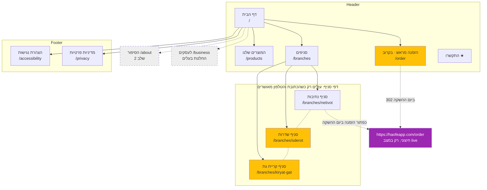

**English summary.** I wrote the information architecture for the HaOfe site. It is a flat local-business site, at most 2 levels deep. Branches get one hub page, `/branches`, plus one page per active branch: Netivot, Sderot and Kiryat Gat. Each branch has its own Google listing, its own address and phone, and its own kashrut level. Only 3 branches makes unique content per page practical. A branch page goes live only once the owner confirms its address and phone; until then, links point to that branch's card on the hub. The ordering app has one manual setting, `orderApp.status` (`soon`/`live`), applied when the site is built. While it is `soon`, the haofeapp.com URL appears nowhere in the site's output, and the marketing domain serves its own `/order` page saying online ordering is coming soon. On launch day that setting alone switches 8 places, listed in section 6. Not built without the owner's decision: accounts, payments, prices, sign-up forms, delivery, a chain-wide kashrut badge, and pages for the Beit Shemesh branches or the factory. The existing prototype B already puts the live app URL in its HTML, hidden by CSS, and two of its branch cards are out of date (section 10). I did no web access in this step. The plan uses only the supplied FACTS and the files in the repo.

---

# ארכיטקטורת אתר: האופה, בוטיק לחם (24.10.2026)

## 0. העובדות שהתוכנית נשענת עליהן
| נתון | ערך | מקור (תאריך) | איך להשתמש |
|---|---|---|---|
| סניפים פעילים | נתיבות, שדרות, קריית גת | https://www.instagram.com/p/DegS23RIAJ-/ (15.10.2026) | להציג |
| נתיבות | שדרות ירושלים 136 · 08-9752093 | https://haofeapp.com/order (נצפה 24.10.2026) · https://www.google.com/maps?cid=11794734948161764260 (24.10.2026) | להציג. הבעלים מחליט איזה טלפון יהיה הראשי |
| שדרות | יגאל אלון 4 | https://www.instagram.com/p/DeghqXvtZje/ (15.10.2026) · https://www.google.com/maps?cid=10594881781052471767 (24.10.2026) | להציג את הכתובת. בפוסט מ־2024 כתוב 6 |
| טלפון שדרות | 08-6491122 | גוגל מפות (24.10.2026), בד״ץ (עמוד מ־2022) | רק אחרי אישור הבעלים |
| קריית גת | הרימון 70 | https://www.instagram.com/p/DeJXIltIyeh/ (6.10.2026) · https://www.google.com/maps?cid=4460162658001013556 (24.10.2026) | להציג את הכתובת |
| טלפון קריית גת | שלושה מספרים סותרים | ביו הסניף באינסטגרם, גוגל ובד״ץ, אתרי מדריכים | לא לפרסם עד שהבעלים מחליט |
| שעות פתיחה | ארבעה מקורות לא מסכימים, בכל הסניפים | haofeapp, גוגל, zips, bakerias (24.10.2026) | לא לפרסם עד אישור |
| כשרות | שדרות: מהדרין חלבי + פרווה. קריית גת: מהדרין פרווה בלבד. לחנות בנתיבות אין רשומה | https://www.badatz.biz/search/?qs=%D7%94%D7%90%D7%95%D7%A4%D7%94 (24.10.2026) | לפי סניף, ורק מתוך תעודה |
| בית שמש | האמוראים 12 סגור לצמיתות. קניון נעימי: מצב לא ידוע | גוגל מפות (24.10.2026) · https://www.instagram.com/p/DeL3jB-CK0u/ (7.10.2026) | לא להציג |
| בית ייצור, הסוללים 1 | מפעל, לא מקום שלקוחות מגיעים אליו | בד״ץ (עמוד עודכן 2023-02-26) | לא להציג ככתובת |
| אפליקציית ההזמנות | לפי הבעלים לא פעילה. בפועל /order מחזיר 200 עם טופס מלא, נתיבות בלבד ואיסוף עצמי בלבד | הבעלים · haofeapp.com/order (24.10.2026) | מצב "בקרוב" בלבד |
| קטלוג | 49 פריטים בלי מחירים: 22 לחמים, 25 מאפים, 2 יבשים | haofeapp.com/order (24.10.2026) | רק אחרי שהבעלים מאשר את הרשימה |

## 1. היררכיית דפים
```
דף הבית (/)
├── המוצרים שלנו (/products)            [אחרי שהבעלים מאשר את הרשימה]
├── סניפים (/branches)                   [דף מרכזי, עולה בהשקה]
│   ├── סניף נתיבות (/branches/netivot)       [מוכן: כתובת וטלפון מאומתים]
│   ├── סניף שדרות (/branches/sderot)         [ממתין לאישור טלפון]
│   └── סניף קריית גת (/branches/kiryat-gat)  [ממתין להחלטה על הטלפון]
├── הזמנה מראש (/order)                  [דף "בקרוב", noindex. ביום ההשקה הופך ל־302]
├── הסיפור שלנו (/about)                 [שלב 2, חסר תוכן מהבעלים]
├── לעסקים (/business)                   [רק אם הבעלים מחליט]
├── הצהרת נגישות (/accessibility)
├── מדיניות פרטיות (/privacy)
└── 404
```
כללי URL:
- כתובות באותיות לטיניות. כתובת בעברית מקודדת ל־%D7… כשמשתפים אותה בוואטסאפ, בדפוס או בקוד QR.
- אותיות קטנות בלבד, בלי לוכסן בסוף. `/branches/` מופנה ל־`/branches`.
- גרסה אחת של הדומיין, עם www או בלי, והשנייה מופנית אליה.

## 2. מפת אתר ויזואלית


## 3. טבלת דפים
| דף | URL | הורה | מקום בניווט | עדיפות | מצב |
|---|---|---|---|---|---|
| דף הבית | `/` | — | לוגו | קריטי | לבנות |
| סניפים | `/branches` | בית | header, סרגל תחתון, footer | קריטי | לבנות |
| סניף נתיבות | `/branches/netivot` | סניפים | footer, הדף המרכזי | גבוהה | לבנות |
| סניף שדרות | `/branches/sderot` | סניפים | footer, הדף המרכזי | גבוהה | ממתין לאישור הטלפון |
| סניף קריית גת | `/branches/kiryat-gat` | סניפים | footer, הדף המרכזי | גבוהה | ממתין להחלטה על הטלפון |
| המוצרים שלנו | `/products` | בית | header, סרגל תחתון | בינונית | אחרי אישור הקטלוג |
| הזמנה מראש | `/order` | בית | header, footer | בינונית | דף "בקרוב", noindex, לא במפת האתר |
| הצהרת נגישות | `/accessibility` | בית | footer | חובה* | לבנות |
| מדיניות פרטיות | `/privacy` | בית | footer | חובה | תוכן לפי מה שהאתר אוסף |
| הסיפור שלנו | `/about` | בית | header (כשיהיה) | נמוכה | שלב 2 |
| לעסקים | `/business` | בית | footer | — | החלטת בעלים |

\* תקנה 35ה מחייבת הצהרת נגישות. היא לא חלה על עוסק פטור או על עסק שהמחזור השנתי הממוצע שלו עד 100,000 ₪ (תקנה 35ו(ז)). מקור: https://www.nevo.co.il/law_html/law01/500_865.htm. נדרש אישור מהבעלים או מעורך דין.

## 4. ניווט
**Header בדסקטופ (מימין לשמאל):**
- הלוגו מימין, מקשר לדף הבית.
- פריטים: מוצרים | סניפים | הזמנה מראש `בקרוב` | (הסיפור, כשיהיה).
- כפתור CTA משמאל: **"התקשרו"**. הוא פותח בחירת סניף, שבה מופיעים רק מספרים מאושרים: נתיבות היום, ושדרות אחרי אישור.
- אם הבעלים יקבע ש־1700-55-22-55 הוא קו ההזמנות של הרשת, הכפתור יחייג אליו ישירות (החלטה 1).

**מובייל:** ב־header רק לוגו ותפריט המבורגר.
- **סרגל תחתון במצב soon (3 פריטים):** סניפים (`/branches`, עם כפתורי ניווט לכל סניף) | חיוג (בחירת סניף, כמו ב־header) | מוצרים.
- **במצב live (4 פריטים):** נוסף פריט מודגש "הזמנה · נתיבות".
- סניף שעוד אין לו טלפון מאושר לא יופיע בחיוג. אסור לחייג אוטומטית למספר לא מאומת.

**Footer:**
- **סניפים:** נתיבות, שדרות, קריית גת, כל אחד עם עיר ורחוב. הקישור הולך לדף הסניף, ואם הדף עוד לא עלה, ל־`/branches#slug`. ובסוף "כל הסניפים".
- **האופה:** מוצרים, הזמנה מראש (בקרוב), הסיפור ולעסקים כשיהיו.
- **עקבו:** @haofe_bakery, @haofe_sderot, @haofe_kiryatgat, ו־facebook.com/haofesderot. אחרי אישור יתווסף גם טיקטוק: הוא מופיע באב־טיפוס ולא נבדק בשלב הזה.
- **מידע:** הצהרת נגישות, מדיניות פרטיות, ושורת ישות משפטית (חסרה, ראו פער 7).
- **אסור ב־footer:** קישור ל־haofeapp.com. כתובת השורש היא מסך "כניסה לצוות". גם תג כשרות אחד לכל הרשת אסור.

**פירורי לחם:** בכל דף חוץ מדף הבית, למשל `דף הבית › סניפים › סניף שדרות`, יחד עם BreadcrumbList ב־JSON-LD.

## 5. סניפים: דף מרכזי ודף לכל סניף
**ההחלטה:** `/branches` מציג את כל הסניפים הפעילים, ולכל סניף יש גם דף משלו.

**למה, מבחינת SEO מקומי:**
1. לכל סניף יש פרופיל גוגל נפרד, עם cid משלו (נצפה 24.10.2026). אפשר להגדיר לכל פרופיל דף שהשם, הכתובת והטלפון בו זהים בדיוק לפרופיל. זו המלצה ולא נתון ממקור.
2. החיפושים מקומיים לפי עיר, ושלוש הערים שונות.
3. יש הבדלים אמיתיים בין הסניפים: טלפון, כשרות (בד״ץ), חשבון אינסטגרם, והזמנה אונליין שקיימת רק בנתיבות.
4. עם 3 סניפים בלבד אפשר לכתוב לכל דף תוכן ייחודי. זה מונע דפים כפולים שמחליפים רק את שם העיר.

**הדף המרכזי עדיין נחוץ:** הוא המקום שבו בוחרים סניף, הוא מרכז הקישורים הפנימיים, והוא היעד כל עוד דף סניף לא עלה.

**מה יש בדף סניף:**
- כותרת H1: "האופה בוטיק לחם · סניף {עיר}".
- כתובת, ניווט בגוגל מפות (לפי ה־cid) ובוויז (הקישור לפי הכתובת. את קישור הוויז שבאפליקציה לא בדקתי).
- טלפון, רק אם אושר.
- שעות, רק אם אושרו. אחרת השורה "לשעות פתיחה התקשרו לסניף".
- כשרות, רק מתוך תעודה שהבעלים מסר.
- אינסטגרם של הסניף.
- הזמנה מראש: רק בנתיבות.
- קישורים ל"סניפים נוספים".
- JSON-LD מסוג `Bakery` עם `parentOrganization`.
- **מתי דף עולה:** רק כשהכתובת וטלפון אחד אושרו. אלה גם התנאים להגדיר את הדף כאתר בפרופיל הגוגל של הסניף.

**מבנה הנתונים:**
- קובץ אחד מזין גם את הדף המרכזי וגם את דפי הסניפים.
- לכל שדה יש סימון `confirmed`, ושדה לא מאושר לא מוצג.
- שום תווית "לאישור" לא מגיעה לאתר בייצור.

## 6. אפליקציית ההזמנות: "בקרוב" ומתג ההשקה
```js
orderApp: {
  status: 'soon',                     // 'soon' | 'live'. משנים ידנית בלבד, אחרי אישור בכתב מהבעלים
  url: 'https://haofeapp.com/order',  // https, בלי לוכסן בסוף, בלי www, לעולם לא כתובת השורש
  branches: ['netivot'],              // ההיקף שמופיע בתוויות. איסוף עצמי בלבד
}
```
**כללים:**
- המצב נקבע בזמן ה־build ולא מוסתר ב־CSS או JS.
- במצב soon המחרוזת `haofeapp` לא מופיעה בשום מקום בפלט: לא ב־HTML, לא במפת האתר, לא ב־JSON-LD ולא ב־OG.
- בדיקת CI: `grep -r haofeapp dist/` חייבת להחזיר תוצאה ריקה כש־status=soon.
- לא מזהים את המצב אוטומטית: `/order` מחזיר 200 בכל מקרה.
- לא מטמיעים את האפליקציה ב־iframe, כי היא שולחת `X-Frame-Options: DENY`.

| מקום | soon | live |
|---|---|---|
| פריט "הזמנה מראש" ב־header | קישור לדף `/order` שלנו, עם תג "בקרוב" | קישור ל־`https://haofeapp.com/order`, עם תג "איסוף בנתיבות" |
| סרגל תחתון | 3 פריטים | נוסף "הזמנה · נתיבות" |
| אזור ההזמנה בדף הבית | "בקרוב: הזמנה מראש אונליין. עדיין לא פעיל ולא ניתן להזמין כרגע", ו־`<span>` שאי אפשר ללחוץ עליו. מתחתיו חיוג לנתיבות 08-9752093 | כפתור "הזמנה לאיסוף מסניף נתיבות" |
| כרטיס נתיבות ודף הסניף | תג "הזמנה אונליין · בקרוב" שאי אפשר ללחוץ עליו, וכפתור חיוג | כפתור קישור לאפליקציה |
| שדרות וקריית גת | חיוג בלבד | ללא שינוי. ישתנה רק אם `branches` יורחב |
| `/order` בדומיין שלנו | 200, noindex, מסביר שעדיין לא פעיל ומציג טלפונים | 302 ל־`https://haofeapp.com/order`. כלל ההפניה נוצר מאותו משתנה. 302 ולא 301, כדי שאפשר יהיה לבטל |
| JSON-LD | אין `potentialAction` | `OrderAction` רק על הישות של נתיבות |
| footer | קישור ל־`/order` | קישור לאפליקציה |

- **ביטול:** מחזירים את המשתנה ל־`soon` ופורסים מחדש.
- **מה לא נכתב בעמוד "בקרוב":** תאריך השקה, מחירים, משלוחים, או אילו סניפים יכוסו. היקף "נתיבות" מוצג רק אם הבעלים מאשר. הבסיס: סעיפים 2(א)(3) ו־7(ב) בחוק הגנת הצרכן, https://www.nevo.co.il/law_html/Law01/089_001.htm. ההנמקה היא שלי.
- **לפני שמעבירים ל־live:**
  - הבעלים מאשר בכתב.
  - הבעלים מבצע הזמנת ניסיון ובודק שהגיע אישור בוואטסאפ ושההזמנה מופיעה בלוח של הצוות.
  - ההיקף בפועל (סניפים, איסוף בלבד, שישי בטלפון בלבד) תואם את התוויות.
  - דפי החובה של האפליקציה עצמה (גילוי לפי 14ג, הודעה לפי סעיף 11, הצהרת נגישות) הם באחריות הבעלים והמפתח.
- **התראה לבעלים כבר עכשיו:** `https://haofeapp.com/order` פתוח לציבור, עם טופס שנראה פעיל ובלי noindex (24.10.2026). כדאי לבקש מהמפתח לסגור אותו או לחסום אותו ממנועי חיפוש, ולבדוק שלא הגיעו הזמנות בטעות.

## 7. קישור פנימי
- **דף הבית:** קישור ל־`/branches` ולשלושת כרטיסי הסניפים, ל־`/products` ולאזור ההזמנה.
- **דף סניף:** קישור לדף המרכזי דרך פירורי הלחם, לשני הסניפים האחרים, ל־`/products`. בנתיבות גם קישור להזמנה.
- **`/products`:** קישור ל־`/branches` עם הטקסט "איפה קונים". אין לרמוז שכל פריט קיים בכל סניף, כי המבחר בכל סניף לא ידוע.
- **`/order` במצב soon:** קישור ל־`/branches/netivot` ול־`/branches`.
- **404:** קישור לדף הבית ול־`/branches`.
- **טקסט הקישור:** תיאורי, למשל "סניף האופה בשדרות" ולא "לפרטים".
- **אין דף יתום:** כל דף סניף מקושר מהדף המרכזי, מדף הבית ומה־footer. הקישורים נוצרים מהנתונים, כך שאין קישור שבור לדף שעוד לא עלה.

## 8. מה לא בונים בלי החלטת בעלים
1. חשבונות, התחברות או אזור אישי, ושום קישור למסך "כניסה לצוות" בשורש haofeapp.com.
2. תשלומים, עגלה, מחירים באתר, מקדמות או הזמנות מוקדמות. אלה מפעילים את 14ג, 17ב ו־13(ב) בחוק הגנת הצרכן.
3. טופס "עדכנו אותי", ניוזלטר או SMS. טופס כזה דורש הודעה לפי סעיף 11, הסכמה נפרדת שהמשתמש מסמן בעצמו (חוות דעת הרשות להגנת הפרטיות מ־25.2.2026), ועמידה בסעיף 30א. ברירת המחדל: "נעדכן באינסטגרם", בכפוף לאישור.
4. מועדון לקוחות, משלוחים, תגי App Store או Google Play.
5. תג כשרות אחד לכל הרשת.
6. דפים לבית שמש, ובית הייצור כמקום ביקור.
7. ביקורות או המלצות. אין מקור, ואסור להמציא.
8. דף לכל מוצר ובלוג. אין להם תוכן.
9. פיקסלים ואנליטיקה, עד שתתקבל החלטה על הסכמה.
10. דף "לעסקים" עם טענות על הפצה.

## 9. פערים ושאלות לבעלים
1. איזה טלפון לפרסם לכל סניף? והאם 1700-55-22-55 הוא קו ההזמנות של הרשת, ש־header יחייג אליו?
2. שעות פתיחה לכל סניף, בעיקר שעת הסגירה בשישי ושעת הפתיחה במוצאי שבת.
3. תעודות כשרות בתוקף לכל סניף. לחנות בנתיבות אין רשומה בבד״ץ.
4. אישור למספר הבית בשדרות: 4 ולא 6.
5. האפליקציה: היקף בהשקה, ובינתיים סגירה או חסימה מאינדוקס של `/order`.
6. הדומיין של האתר השיווקי. ב־haofeapp.com כתובת השורש תפוסה על ידי מסך הצוות, ו־www לא קיים.
7. שם הישות המשפטית וח.פ., פרטי רכז הנגישות, והאם העסק פטור לפי 35ו(ז).
8. אישור רשימת המוצרים, ואילו מוצרים יש בכל סניף.
9. האם להזכיר את סניפי בית שמש לשעבר. ברירת המחדל: לא.
10. כשדפי הסניפים עולים: להגדיר אותם כאתר בפרופילי הגוגל, ולתבוע בעלות על הפרופיל של קריית גת. נראה שהוא לא נתבע, אבל זו הסקה שלי.
11. לא לקרוא לנתיבות "סניף ראשי", אלא אם הבעלים אומר זאת.

## 10. אב־טיפוס B הקיים (`/home/user/edon-studio/clients/haofe/concepts/b.html`)
- **שורה 311:** הקישור `href="https://haofeapp.com/order"` נמצא ב־HTML גם במצב soon, ומוסתר רק ב־CSS בעזרת `.when-live`. צריך להחליף את זה ברינדור בזמן build.
- **כרטיס שדרות:** כתוב "כתובת מ־2021, לאישור". הכתובת אומתה בפוסט של הסניף מ־15.10.2026.
- **כרטיס קריית גת:** כתוב "כתובת לאישור". הכתובת הרימון 70 מופיעה בפוסט של הסניף מ־6.10.2026.
- **סרגל תחתון:** "ניווט" מוביל רק לנתיבות. צריך לקשר ל־`/branches`.
- **חיוג:** ה־CTA והסרגל התחתון מחייגים ל־1700 לפני שהבעלים החליט.
- **אזור לעסקים:** "לסופרים בכל הארץ" לא מופיע בעובדות שקיבלתי. דף המחקר מייחס את זה לדברי המשתמש מ־24.10.2026, לביו בטיקטוק ולוואלה 2021, ואילו בעובדות הקשר לוויקטורי נדחה. צריך ניסוח מאושר מהבעלים, בלי שמות רשתות.

**לא נגיש:** בשלב הזה לא פתחתי שום כתובת. התוכנית נשענת רק על העובדות שסופקו ועל קבצי הריפו.